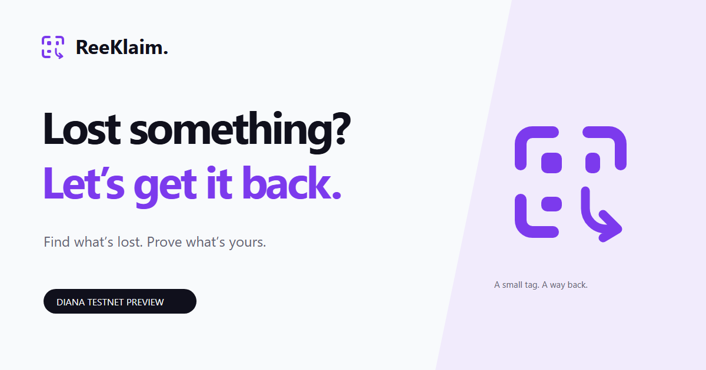

# ReeKlaim

**Find what's lost. Prove what's yours.**

ReeKlaim is a privacy-conscious lost-and-found for physical belongings. Browse missing and found reports, label belongings with recovery QR tags, and coordinate returns through private claims. It runs on QoreChain's Diana testnet.



## How it works

| Who | What they can do |
| --- | --- |
| Anyone | Search public listings or scan a recovery QR tag to send a private, one-way finder report. |
| Owners | Sign in with QoreX, keep private item records, publish a lost report, and register a commitment to activate a printable QR tag. |
| Finders and claimants | Publish reports, review suggested matches, submit private evidence, coordinate with the other party, and confirm a return. |
| Organizations | Invite staff, track found-property inventory, and record custody reviews in a private workspace. |

The dashboard brings together items, claims, recoveries, notifications, settings, and transaction receipts. The demo uses fictional records. Registration timestamps a wallet's ownership assertion. Claim reviewers still assess evidence.

## Quick start

Use Node 22.22.2 or newer in the 22.x line and security-patched PostgreSQL. On Windows, the setup starts a dedicated PostgreSQL cluster on loopback port 55439. If PostgreSQL is installed elsewhere, set `POSTGRES_BIN` to its `bin` directory.

```powershell
npm.cmd ci --ignore-scripts
npm.cmd run db:setup
npm.cmd run dev
```

Open [127.0.0.1:5173](http://127.0.0.1:5173/) in the browser with QoreX installed. Use that exact origin throughout. In QoreX, select Diana testnet, connect, and review the sign-in approval. Public browsing is available without a wallet. [Local setup](docs/PHASE_3_SETUP.md)

## How it's built

- **Browser** — React, TypeScript and Vite. QoreX handles approvals.
- **API** — A same-origin Node service validates inputs, verifies canonical Diana receipts, and issues cookie sessions backed by PostgreSQL.
- **Data** — Restricted database roles and forced row-level security scope records to their account or organization. Private files are encrypted before storage and served through short-lived, session-bound links.
- **Chain** — Native Diana transfers bind randomized registration commitments. Descriptions, serial numbers and ownership evidence stay off-chain.

[Architecture and API map](docs/ARCHITECTURE.md) · [Migrations](database/migrations) · [Security model](docs/SECURITY_THREAT_MODEL.md)

## Validation

```powershell
npm.cmd run lint
npm.cmd run typecheck
npm.cmd test
npm.cmd run build
npx.cmd playwright install chromium
npx.cmd playwright test -c playwright.release.config.ts
```

Phase 10 recorded 68 passing local Chromium checks, 163 unit and PostgreSQL checks passing across split runs, and an independently reverified Diana registration receipt. The browser suite uses wallet fixtures for most signed-in flows. [Release report](docs/PHASE_10_REPORT.md) · [Diana evidence](docs/TESTNET_EVIDENCE.md)

## Deploy

Use the [deployment runbook](docs/DEPLOYMENT.md) to configure staging, a restricted PostgreSQL database, and private object storage. The candidate [Vercel config](vercel.phase10.json) uses the root Node entry and the built Vite app. Hosted smoke tests and the live two-account recovery flow remain open. Keep production payment gates off until the corresponding release checks pass. All transfers are Diana testnet only. [Environment template](.env.example) · [Hosted smoke checklist](docs/PRODUCTION_SMOKE_TEST.md)

## Credits and license

ReeKlaim's original code is [MIT licensed](LICENSE). It builds on the official QoreChain scaffold and open-source packages. See [third-party notices](THIRD_PARTY_NOTICES.md) and [AI usage](AI_USAGE.md).

