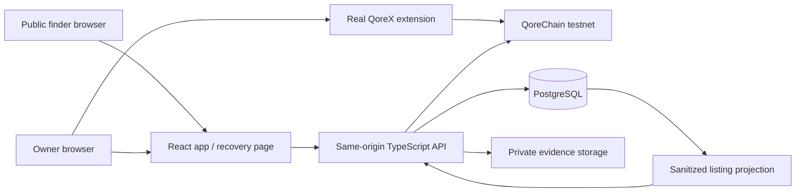

# Architecture

## Phase 4 implementation — 18 November 2026

The existing root React/Vite scaffold now has owner-authorized item registration services, encrypted versioned snapshots, exact native payment intents and public QR projections. `server/items`, `src/items` and migrations 004–005 extend the Phase 3 foundation. Read [registration design](ITEM_REGISTRATION_DESIGN.md), [setup](PHASE_4_SETUP.md) and [Phase 4 report](PHASE_4_REPORT.md) for current paths and acceptance. Genuine wallet/receipt, HTTPS deployment and native-only event eligibility remain pending. The original proposal below is historical; no contract or public deployment is claimed.


Status: proposed implementation, researched 17 November 2026. No deployed components.

## System boundary



The server verifies chain receipts and sessions. The browser/provider is untrusted input. A finder can view a recovery page and report an item without a wallet. Only an authenticated QoreX account owns a ReeKlaim account. Anonymous finder continuity uses a limited report token; it never grants owner permissions.

## ADR-001: retain the actual official React scaffold

Use `create-qorechain-dapp@0.14.0 --template fullstack-web --network testnet --no-install --yes` for `apps/web` in Phase 1. Keep the generated React entry points, TypeScript/Vite configuration and SDK integration, then evolve them. Record generated file hashes before edits. The template is a frontend with SDK reads despite the name "full-stack"; authentication, database and API are new original work.

The temporary probe generated successfully in Phase 0. Its `.env` selected `/lcd`, REST testnet proxy and EVM testnet RPC. Generated `.env.example` retains localhost placeholders; template code/preview proxy are not production security controls. Require explicit testnet config, server-side network checks and no silent localhost/mainnet fallback in the final app.

Planned layout:

```text
apps/web/                 retained and extended official Vite/React scaffold
api/                      same-origin Node function adapters
packages/domain/          schemas, amounts, state transitions, commitments
packages/chain/           QoreX adapter, encoders, independent receipt verification
packages/server/          sessions, authorization, storage, operation services
database/migrations/      schema, RLS, indexes, restricted roles
tests/                    unit, integration, mock E2E, separate real-wallet evidence
docs/evidence/            sanitized real deployment and transaction receipts
```

These paths describe future implementation; they do not presently exist.

## ADR-002: native transactions first

Pin `@qorechain/sdk@0.14.0` and `@qorechain/qorex-types@0.1.0` initially. Recheck when installing. Encode official Cosmos bank `MsgSend`; use `getQorexNative`, `hasCapability` and `qorexSignAndBroadcast`. Do not invent a wallet `signIn`, request raw keys, or assume SDK private-key signer examples are appropriate for users. Prefer official generated protobuf encoders over copying the workshop's manual encoder.

Native memos anchor opaque commitments for registration and later accepted transitions. PostgreSQL holds the operational record. This is an application-managed registry with public transaction evidence, not a trustless NFT or an on-chain legal-title system. Server/database compromise can still alter off-chain decisions. The product must say so.

Rejected defaults: wagmi/MetaMask authentication (wrong wallet and unavailable signing methods); a self-custody server signer for users (keys leave the wallet); CosmWasm upload (governance gate); a token/rollup (does not solve recovery). If G2 requires a contract, see the meaningful registry branch in [blockchain design](BLOCKCHAIN_INTEGRATION.md).

## ADR-003: custom sessions and a narrow server API

Use server-created opaque cookie sessions backed by PostgreSQL. Supabase Auth login is not required. Browser never connects directly to private tables. A dedicated runtime DB role uses forced RLS and per-transaction identity context derived from verified sessions. Separate migration/admin credentials from runtime. Private storage access is issued only after server authorization.

Implemented ReeKlaim API route families:

| Route | Access and purpose |
|---|---|
| `GET /api/auth/session`, `POST /api/auth/{challenge,verify,logout}` | Session discovery, single-use challenge and canonical receipt, protected mutations |
| `GET /api/me`, `/api/dashboard` | Authenticated account/private summaries |
| `/api/items`, `/api/items/:id`, `POST /api/items/:id/{intent,approval,verify}` | Owner-scoped item editing and registration receipt checks |
| `GET /api/recover/:token`, `POST /api/recover/:token/contact` | Sanitized public recovery card and rate-limited finder contact |
| `/api/market`, `/api/market/:id` | Bounded public listing reads and authenticated report management |
| `/api/claims/*`, `/api/payments/*` | Case participants only, with role and state checks for claim and payment actions |
| `POST /api/private/evidence`, `POST /api/private/evidence/:id/link`, `GET /api/private/evidence/:id/download` | Authorized private uploads and short-lived, session-bound downloads |
| `GET /api/workspace/overview`, `/api/workspace/notifications`, `/api/workspace/organizations` | Account-scoped statistics, notifications and tenant-authorized operations |

Routes use Zod, strict body sizes, parameterized queries, and bounded pagination. CSRF tokens and exact Origin validation protect state-changing routes, including challenge issuance.

## Consistency and operations

State changes requiring a chain anchor are `draft → awaiting_wallet → broadcast_submitted → verifying → confirmed`, with `rejected`, `expired`, `failed` and `manual_review` outcomes. A broadcast acknowledgement is not confirmation. Poll the server with bounded backoff; a persisted operation permits recovery after refresh. Unique `(chain_id, tx_hash)` and operation IDs prevent double use. A failed database write after chain success is reconciled idempotently; never demand payment again because the UI lost a response.

No permanent background worker is required for MVP. User-triggered bounded receipt rechecks and a human-run reconciliation command drain durable pending operations. Add free scheduled reconciliation only if the selected host permits it. Observe request IDs, verification failures, rate limits and database/endpoint health without logging private descriptions, cookies, evidence or complete authentication payloads.

## Deployment and budget

Develop locally with Node, Vite, PostgreSQL and private local file storage (or a free Supabase project). Package static `dist` plus Node API handlers with SPA routing; `/api/*` takes precedence. Implement a fixed, allowlisted server chain-read adapter to solve REST CORS. Vite's development proxy does not exist on a static production host.

Vercel compatibility is an engineering target, not permission to use a free plan commercially. [Vercel pricing](https://vercel.com/pricing) describes Hobby as personal/non-commercial. Obtain host eligibility for the event demo before using it; never silently upgrade to a paid tier. If ineligible, select and verify another eligible free host and port the thin adapters, or retain a local demo while the public deployment gate stays open. [Supabase Free](https://supabase.com/pricing) currently lists 500 MB database/1 GB storage and inactivity pausing; keep a small synthetic dataset, export an encrypted backup and check project health before demo. No paid production-readiness promise.

Server secrets: database connection, session/commitment keys, storage server credentials if used. Public config: origin, testnet label, public treasury once approved. Build/deploy must scan for private credentials and reject unsupported network configuration. Run smoke tests on the deployed origin: refresh deep links, QR scanning, cookies, DB persistence, server chain reads and authentication expiry. Deployment alone does not prove category compliance.

## Phase 5 marketplace

Public search and authenticated reporting extend the existing same-origin middleware. See [marketplace design and API inventory](MARKETPLACE_DESIGN.md) for trust boundaries, lifecycle, moderation and SQL migrations.

## Phase 6 private cases

The claims service reuses the actor-scoped database, encrypted storage and canonical Diana receipt verifier. Match ranking reads only approved listing fields. Participant-only claim state and evidence never enter the public marketplace projection. See [claims design](CLAIMS_DESIGN.md).

## Phase 8 workspace and organizations

Migrations 013–015 add account preferences, deletion requests, notification events and tenant inventory. The private API keeps existing QoreX identity and payment gates. Organization membership is separate from personal data access. See [design and API inventory](WORKSPACE_DESIGN.md).
